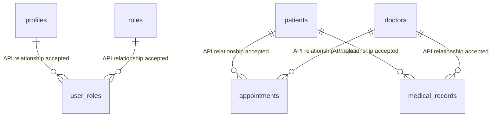
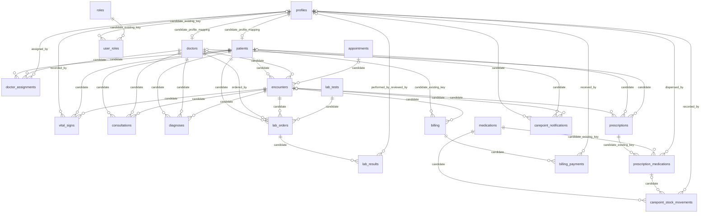

# Carepoint database schema reference

## Evidence and limits

This reference separates facts exposed by the published project's PostgREST API from definitions in local SQL. It is not a substitute for an owner-run catalog export.

- **LIVE_CONFIRMED**: the relation and listed field names have previously been accepted by the configured public PostgREST API, or the documented join was accepted. This does not prove SQL types, constraints, or write authorization.
- **REPOSITORY_CONFIRMED**: explicitly declared or assumed by the checked-in candidate SQL. It has not been verified against the published database.
- **FIXTURE_ONLY**: tested only against a disposable local schema.
- **UNKNOWN**: not established by available evidence.

The latest live health probe found all 12 core relations queryable. The ten workflow relations returned `PGRST205`, which means they are absent from the current PostgREST schema cache. It does **not** establish whether a physical relation exists. No authorized SQL catalog output is available in this workspace; consequently exact live types, nullability, defaults, keys, constraints, indexes, policies, grants, triggers, and RPCs remain **UNKNOWN**. Do not run the migration until an owner reviews the preflight output.

No Supabase-generated TypeScript `Database` type file exists in this project. [`src/types.ts`](../src/types.ts) contains application/UI models, not generated database definitions. It is unsafe to create an authoritative live `Database` type until catalog metadata is supplied; query return shapes are currently inferred from the untyped Supabase client.

## Existing public relations

For these relations the listed names are **LIVE_CONFIRMED** as accepted API fields. Every SQL type, nullability, default, generated property, primary/unique/check constraint, index, RLS policy, and grant is **UNKNOWN** unless stated otherwise.

| Relation | Accepted fields | Schema status |
|---|---|---|
| `profiles` | `id`, `full_name`, `phone`, `created_at` | LIVE_CONFIRMED |
| `roles` | `id`, `name`, `description` | LIVE_CONFIRMED |
| `user_roles` | `user_id`, `role_id`, `assigned_at` | LIVE_CONFIRMED |
| `patients` | `patient_id`, `name`, `address`, `created_at` | LIVE_CONFIRMED |
| `doctors` | `doctor_id`, `name`, `specialization`, `created_at` | LIVE_CONFIRMED |
| `appointments` | `appointment_id`, `patient_id`, `doctor_id`, `appointment_date`, `status`, `reason`, `created_at` | LIVE_CONFIRMED |
| `medical_records` | `record_id`, `patient_id`, `doctor_id`, `diagnosis`, `notes`, `treatment_plan`, `created_at` | LIVE_CONFIRMED |
| `lab_tests` | `test_id`, `name`, `description`, `created_at` | LIVE_CONFIRMED |
| `medications` | `medication_id`, `name`, `description`, `created_at` | LIVE_CONFIRMED |
| `prescriptions` | `prescription_id`, `created_at` | LIVE_CONFIRMED |
| `prescription_medications` | `prescription_medication_id`, `prescription_id`, `medication_id`, `dosage`, `instructions` | LIVE_CONFIRMED |
| `billing` | `bill_id`, `patient_id`, `total_amount`, `status`, `created_at` | LIVE_CONFIRMED |

Fields absent from the list are not established as nonexistent; they are simply not accepted/confirmed by the prior probes under those names. In particular, do not assume profile email is stored in `profiles`; the UI obtains it from Supabase Auth. `profile_id`, stock quantity, prescription status/patient, and additional prescription-item fields are candidate migration dependencies, not verified live fields.

## Live-confirmed relationships

These are the only existing relationship paths documented as successfully parsed by PostgREST. The API evidence does not provide delete/update behavior or cardinality constraints.

The arrows show the documented many-to-one join direction from child to referenced record only; they do not assert one-to-one uniqueness.

## Existing roles

The six supported role identifiers are **LIVE_CONFIRMED** in the project’s prior role query and must remain unchanged:

`admin`, `receptionist`, `doctor`, `patient`, `lab_technician`, `pharmacist`.

The table/column used for assignment is exposed as `user_roles.user_id`, `user_roles.role_id`, and `roles.name`. Exact key constraints and RLS semantics remain UNKNOWN. The application rejects ambiguous multiple role assignments. No user may self-assign an administrative role.

## Workflow migration candidate

[`carepoint_complete_migration.sql`](../supabase/migrations/carepoint_complete_migration.sql) is the single authoritative consolidated candidate; it is **REPOSITORY_CONFIRMED**, not live-confirmed. The ten relations below currently have `PGRST205`; their physical existence is UNKNOWN. The candidate intentionally aborts if any proposed workflow relation or guarded object already exists, and it is not designed for reapplication. If owner-side catalog output shows any such object, do not create a duplicate or apply the candidate unchanged; reconcile it with the owner first. Historical SQL files are provenance only, not additional migrations to execute.

The candidate defines the following additional tables and columns. These are candidate definitions only:

| Relation | Candidate columns |
|---|---|
| `doctor_assignments` | `assignment_id`, `patient_id`, `doctor_id`, `assigned_by`, `assigned_at`, `is_active` |
| `encounters` | `encounter_id`, `patient_id`, `doctor_id`, `appointment_id`, `status`, `started_at`, `ended_at` |
| `vital_signs` | `vital_sign_id`, `encounter_id`, `patient_id`, `recorded_by`, `systolic_bp`, `diastolic_bp`, `heart_rate`, `temperature_c`, `respiratory_rate`, `oxygen_saturation`, `weight_kg`, `height_cm`, `notes`, `recorded_at` |
| `consultations` | `consultation_id`, `encounter_id`, `patient_id`, `doctor_id`, `chief_complaint`, `clinical_notes`, `treatment_plan`, `created_at` |
| `diagnoses` | `diagnosis_id`, `encounter_id`, `patient_id`, `doctor_id`, `code`, `description`, `is_primary`, `created_at` |
| `lab_orders` | `lab_order_id`, `encounter_id`, `patient_id`, `ordered_by`, `test_id`, `status`, `priority`, `instructions`, `ordered_at` |
| `lab_results` | `lab_result_id`, `lab_order_id`, `result_value`, `units`, `reference_range`, `result_notes`, `status`, `performed_by`, `reviewed_by`, `performed_at`, `published_at` |
| `billing_payments` | `payment_id`, `bill_id`, `amount`, `payment_method`, `reference`, `received_by`, `paid_at`, `idempotency_key` |
| `carepoint_stock_movements` | `movement_id`, `medication_id`, `prescription_medication_id`, `movement_type`, `quantity_before`, `quantity_after`, `notes`, `recorded_by`, `recorded_at` |
| `carepoint_notifications` | `notification_id`, `recipient_profile_id`, `patient_id`, `encounter_id`, `event_type`, `message`, `created_at`, `read_at` |

The candidate also adds nullable `patients.profile_id` and `doctors.profile_id`, `encounter_id`/patient/doctor/status fields to `prescriptions`, `encounter_id` to `billing`, dispensing fields to `prescription_medications`, and `stock_quantity` to `medications`. These extensions are **REPOSITORY_CONFIRMED** only; their production presence is **UNKNOWN**.

Candidate type details (not live-confirmed):

- New table primary keys use `uuid` with `gen_random_uuid()` defaults. `encounter_id` and its references use `uuid`.
- Foreign-key columns referencing existing `profiles`, `patients`, `doctors`, `appointments`, `lab_tests`, `medications`, `prescription_medications`, and `billing` keys are declared using the target key's catalog-derived SQL type. Their exact type is therefore **UNKNOWN** until the owner runs the candidate preconditions against the actual database.
- Candidate timestamps use `timestamptz`; role/status/method/message/code/clinical text fields use `text`; flags use `boolean`; vital integer and decimal measurements use `integer` or the explicit `numeric(p,s)` declarations in the migration.
- Candidate `billing_payments.amount` is `numeric(12,2)`; its unique idempotency key is `uuid NOT NULL DEFAULT gen_random_uuid()`. Candidate stock counters use `bigint`; prescription quantities and vitals use `integer`/`numeric` as declared in the SQL.
- Added profile and workflow columns on existing tables are nullable unless the migration explicitly says otherwise; no preexisting record is backfilled with fabricated identity or stock data.

### Candidate relationship map (not live-confirmed)

The migration derives types for several foreign-key columns from referenced live keys, then asserts the presence of candidate constraints. It does not establish that the referenced columns are currently unique in production. Candidate relationships include:

This is a diagram of migration intent only. Exact FK actions and key types must be read from the SQL and checked against live catalog output before application.

Additional candidate consistency constraints use composite encounter keys: vital signs reference `(encounter_id, patient_id)`; consultations, diagnoses, prescriptions, and laboratory orders reference `(encounter_id, patient_id, doctor_id)` (laboratory orders use `ordered_by` as the doctor key); and billing references `(encounter_id, patient_id)`. This prevents a row from pairing an encounter with a different patient or assigned doctor. The candidate also links patients/doctors to profiles and dispensing records to the dispensing profile. All are candidate-only relationships, not live-confirmed.

## Candidate constraints, indexes, functions, and security

- Candidate status/check constraints cover encounter status, laboratory order status/priority, laboratory result status, stock non-negativity, positive prescription quantity, nonnegative dispensed count, and vital ranges. Several foreign keys/checks are `NOT VALID` so pre-existing rows are not scanned or rejected at creation; new/updated rows remain subject to the constraints.
- Candidate indexes cover assignment lookups, profile mappings, patient/encounter/result/payment/notification access and unique payment idempotency keys. All are **REPOSITORY_CONFIRMED** only.
- Candidate functions are `carepoint_has_role`, `carepoint_schema_ready`, `carepoint_owns_patient`, `carepoint_is_doctor`, `carepoint_is_assigned_doctor`, `carepoint_notify_assigned_doctor`, `carepoint_request_appointment`, `carepoint_record_triage`, `carepoint_assign_doctor`, `carepoint_complete_consultation`, `carepoint_record_diagnosis`, `carepoint_create_lab_order`, `carepoint_set_lab_order_in_progress`, `carepoint_submit_lab_result`, `carepoint_review_lab_result`, `carepoint_create_prescription`, `carepoint_dispense_prescription_item`, `carepoint_adjust_medication_stock`, and the five-argument `carepoint_record_payment`. The sole candidate trigger is `carepoint_20261105_appointment_notification`, an `AFTER INSERT OR UPDATE OF doctor_id, appointment_date` trigger on `appointments` that creates scoped patient/doctor notifications.
- The payment RPC candidate has five arguments `(text, numeric, text, text, uuid)`. It serializes same-key retries, rejects changed retry details, supports partial payments within remaining balance, and locks the bill row against concurrent overpayment. The old four-argument signature is revoked by the candidate. None of these function definitions/privileges is LIVE_CONFIRMED.
- The candidate enables RLS on the 12 current relations and 10 workflow relations. It adds `carepoint_20261105_access` (permissive authenticated access with role/ownership predicates), `carepoint_20261105_guard` (restrictive predicates that prevent writes outside the permitted workflows), and `carepoint_20261105_no_delete` (restrictive denial of deletes) on each protected relation. Policies scope patient access to their profile-linked records, doctor access to assigned patients, and staff access by the relevant receptionist, lab-technician, pharmacist, or admin role. Role assignment is admin-only and disallows self-assignment. Direct writes to workflow records are generally denied in favor of secured RPCs. Existing policy definitions and combined effective access in production are UNKNOWN; the candidate does not remove existing policies, so the owner must review them before applying it.
- The candidate defines notification triggers and restricted function grants. Trigger presence, ownership, `SECURITY DEFINER` settings, and grants in the live project remain UNKNOWN.

For the full proposed DDL, exact migration ordering, compatibility preconditions, and owner-side verification queries, see the [consolidated migration](../supabase/migrations/carepoint_complete_migration.sql), [read-only preflight](../supabase/diagnostics/carepoint_schema_preflight.sql), and [runbook](./carepoint-migration-runbook.md).

## Other schema objects

- Admissions, beds/assignments, departments, ambulance dispatch, audit logs, clinical notes, AI intake, dental, and payment-allocation objects: **UNKNOWN** (not enumerated from the live catalog and not assumed by this candidate).
- Live views/materialized views, custom types/enums, sequences, functions, triggers, grants, PostgREST exposed schemas, and policies: **UNKNOWN** beyond API behavior described above.
- Disposable PostgreSQL migration/workflow/payment scenarios: **FIXTURE_ONLY** as recorded in the runbook. Fixture results are not production evidence.

## Remaining owner-side evidence

Run the preflight as a catalog-authorized database owner and retain its output. It gathers actual columns/types/defaults/nullability, constraints/FKs, indexes, role rows, RLS state/policies, triggers, function definitions/ACLs, and table grants, plus a physical `to_regclass` check for the ten workflow names. Review public schema exposure and PostgREST role grants separately if a relation exists physically but remains absent from the API schema cache. No production migration, write, invitation, or role change has been performed.
